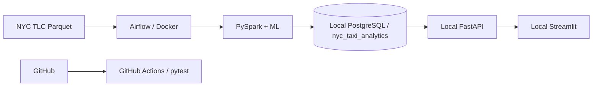

# Deployment

The supported runtime uses local PostgreSQL for analytics and model-serving data. FastAPI serves this database to Streamlit. Docker Compose runs Airflow and its separate metadata PostgreSQL service.

## Architecture

| Technology | Use in the project |
|---|---|
| **Local PostgreSQL** | Analytics and model-serving database |
| **FastAPI** | Local API for dashboard and forecasting |
| **Streamlit** | Local interactive dashboard |
| **Docker Compose** | Airflow and separate metadata database |
| **GitHub Actions** | Automated tests on code changes |

## Configuration & CI

Set `DATABASE_URL` for local FastAPI and ML processes. Airflow containers receive `DATABASE_URL` from `AIRFLOW_DATABASE_URL`; use a hostname reachable from Docker (for example, `host.docker.internal` on Docker Desktop), not container-local `localhost`.

Keep credentials, API endpoints and Slack configuration in local environment variables or untracked secrets. Do not commit credentials.

GitHub Actions runs focused pytest tests on pushes and pull requests to `main` with isolated test configuration. Monthly TLC refreshes are handled by Airflow and the backend pipeline.

After code updates, restart affected local services.

## Legacy hosted endpoints

Previously hosted Streamlit and Render endpoints are not part of the local-only database architecture and are not validated by this migration.
